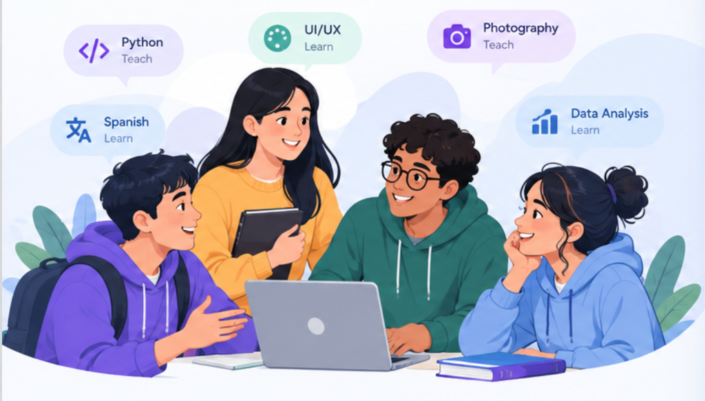

# 🔄 SkillSwap — Student Peer-to-Peer Skill & Material Exchange Platform



> **"I can teach Python" ↔ "I want to learn UI/UX"**
> Connect students, exchange skills without paying for expensive courses, and swap study resources — powered by **FastAPI** and live **MongoDB Atlas Cloud**.

---

## 🌟 Key Features

1. **Smart Barter Matching Engine**: Automatically identifies reciprocal matches (e.g. Student A teaches Python & wants UI/UX; Student B teaches UI/UX & wants Python) with compatibility scoring.
2. **Skill Exchange Requests**: Propose, review, accept, or decline swap requests with custom barter notes and agreed hour balances.
3. **Real-time Live Chat**: WebSocket-powered direct messaging between matched peers for scheduling and exchanging knowledge.
4. **Interactive Session Scheduling**: Schedule Google Meet sessions with calendar time tracking and meeting links.
5. **Peer Reviews & 5-Star Ratings**: Verified peer feedback with tag highlights (e.g., "Figma Wizard", "Actionable Tips").
6. **Student Material Exchange**: Dedicated repository for campus peers to download, like, and barter cheatsheets, UI kits, code boilerplates, and Anki decks.
7. **Cloud MongoDB Atlas Integration**: True cloud multi-tenant database persistence using Motor async driver.

---

## 🛠 Tech Stack

- **Frontend**: React 18, Vite, Lucide Icons, Canvas Confetti, Vanilla CSS Glassmorphism
- **Backend**: Python 3, FastAPI, Uvicorn, Motor (Async MongoDB Driver), Pydantic v2, PyJWT
- **Database**: **MongoDB Atlas Cloud** (Free M0 Cluster `Cluster0`)

---

## 🚀 Quick Start (Local Development)

### 1. Prerequisites
- Node.js (v18+)
- Python (3.9+)
- MongoDB Atlas Account

### 2. Backend Setup
```bash
cd backend
python3 -m venv venv
source venv/bin/activate
pip install -r requirements.txt
cp .env.example .env
# Edit .env with your MongoDB Atlas connection string
uvicorn app.main:app --host 127.0.0.1 --port 8000
```
- API Docs (Swagger UI): `http://127.0.0.1:8000/docs`

### 3. Frontend Setup
```bash
cd frontend
npm install
npm run dev
```
- Web Application: `http://127.0.0.1:5173`

---

## 🧪 Automated Testing

Run the full end-to-end test suite (17 automated checks across all features + MongoDB Atlas persistence):
```bash
cd backend
./venv/bin/python tests/test_skillswap_e2e.py
```

---

## ☁️ Deployment Guide (Live Hosting)

### 1. Backend on Render / Railway
1. Push this repository to GitHub.
2. In [Render.com](https://render.com), create a **New Web Service** connected to your repo.
3. Set:
   - **Root Directory**: `backend`
   - **Environment**: `Python 3`
   - **Build Command**: `pip install -r requirements.txt`
   - **Start Command**: `uvicorn app.main:app --host 0.0.0.0 --port $PORT`
4. In **Environment Variables**, add:
   - `MONGODB_URL`: `mongodb+srv://<user>:<password>@cluster0.witllbk.mongodb.net/?retryWrites=true&w=majority&appName=Cluster0`
   - `DATABASE_NAME`: `skillswap`

### 2. Frontend on Vercel
1. In [Vercel.com](https://vercel.com), import your repository.
2. Set:
   - **Root Directory**: `frontend`
   - **Framework Preset**: `Vite`
   - **Build Command**: `npm run build`
   - **Output Directory**: `dist`
3. In `frontend/src/api.js`, set `API_BASE` to your deployed Render backend URL (e.g. `https://skillswap-api.onrender.com/api`).

---

## 🔍 Proving MongoDB Atlas Cloud Works Live

To verify data is written to the cloud in real time:
1. Open **[cloud.mongodb.com](https://cloud.mongodb.com/)** in any browser.
2. Go to **Database** → **Cluster0** → **Browse Collections**.
3. Select the **`skillswap`** database.
4. Have anyone sign up, swap a skill, or upload a material on the hosted site.
5. Click **🔄 Refresh** in Atlas: the new JSON document immediately appears with timestamps and full details!
